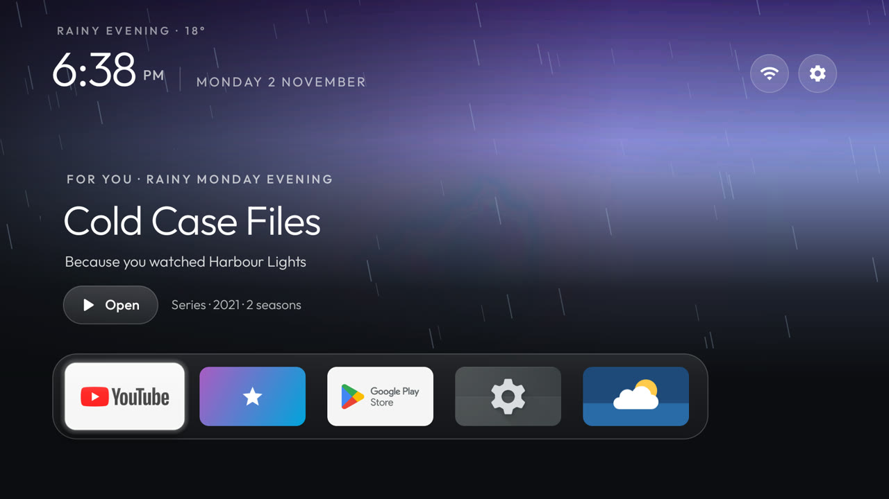
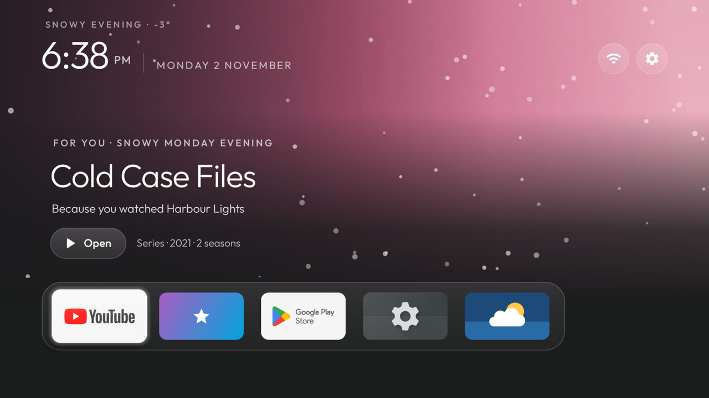
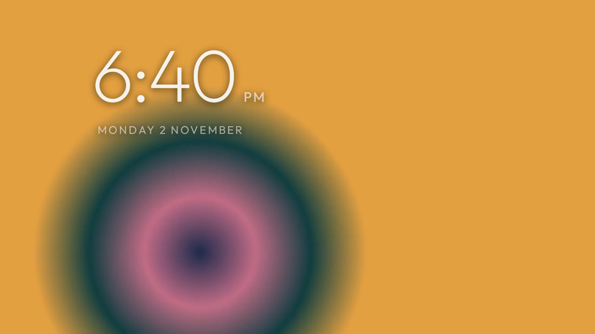
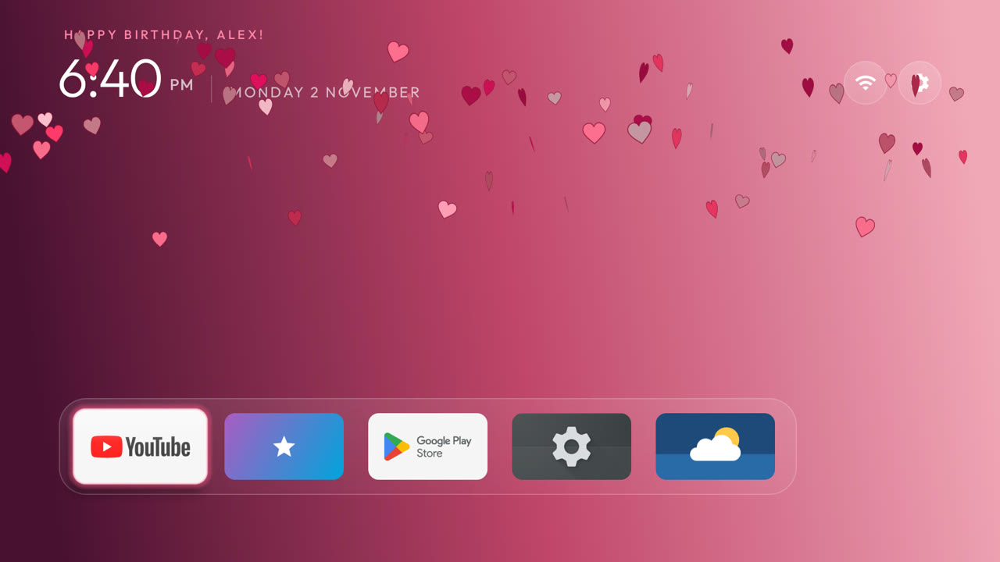

# Home extras: a Clean Your TV fork

This fork adds a livelier Home to the [Clean Your TV](https://github.com/Gathin23/cleanyourtv) reference launcher.
Every feature is **off until a theme turns it on**; the launcher still has **no internet permission** (weather and
picks come from add-ons that read the network and hand the launcher a cached result). Built and used on a Sony BRAVIA
(Google TV 12); the screenshots are from the Android TV 12 emulator.

| Weather on Home | Picks from Jellyfin in the spotlight |
|---|---|
|  |  |
| **Live screensaver** | **Birthday** |
|  |  |

## What it adds

- **Continue watching** (`watch_next_packages`): the rows apps publish to the TV's Continue watching (Jellyfin,
  for example) as a row under the dock, with posters and progress. Needs `READ_TV_LISTINGS`, which
  `launcher/build-and-install.sh` grants.
- **Spotlight** (`continue_spotlight`): the newest Continue watching item as a full-width backdrop above the dock, with
  its episode, time left, a progress bar and **Resume**; Up from the dock reaches it.
- **Picks** (`picks_package`): suggestions from your Jellyfin library take turns with Continue watching in the
  spotlight every 20 s, each with a reason ("Because you watched …", "Rainy evening pick", "Weekend movie night") and
  an **Open** button. They come from the [Jellyfin Picks](addons/jellyfin-picks/) add-on.
- **Weather on Home** (`weather_package`): the [Weather](addons/weather/) add-on publishes the current reading; Home
  tints with it, animates rain, drizzle, storms, snow, fog, sun rays or stars between the wallpaper and the tiles
  (never over the dock or the spotlight's text), names it in the greeting ("Rainy evening · 24°"), and prefers
  wallpapers named for it (`rain-*.jpg`, `sun-*`, `cloud-*`, `fog-*`, `snow-*`, `storm-*`). Off on festival days.
- **Live screensaver** (`screensaver_loops`): each time the screensaver starts, one of the theme's videos
  (`screensaver/*.mp4`, pushed by `tools/theme.sh`) is picked at random, never the last one, and loops muted under
  the clock (with a soft shadow) until a key is pressed. Home's idle clock (`home_idle_clock_minutes`) plays one too.
- **Birthday** (`"festival": "birthday"`, `festival_from`): rose accent, a greeting of your own and hearts falling
  with each new picture; `wallpaper_dates` shows chosen pictures only on given days (`"06-01"` every year, or one date),
  as a slideshow (`wallpaper_dates_seconds`).

## A theme that turns it all on

```json
{
  "watch_next_packages": ["org.jellyfin.androidtv"],
  "continue_spotlight": true,
  "picks_package": "io.github.zendeveloper7.picks",
  "weather_package": "io.github.sumyabazar1.weather",
  "screensaver_loops": true,
  "festival": "birthday",
  "festival_from": "2026-06-01",
  "festival_until": "2026-06-01",
  "greeting": "Happy birthday!",
  "wallpaper_dates": { "06-01": ["birthday-1.jpg", "birthday-2.jpg"] },
  "wallpaper_dates_seconds": 10
}
```

Put the videos in the theme's `screensaver/` folder (1080p H.264 plays best; the push is about 200 KB/s, so keep them
under ~20 MB) and the birthday pictures in `wallpapers/`, then `TV_HOST=<tv ip> tools/theme.sh <theme folder>`.

## Add-ons

- **[Jellyfin Picks](addons/jellyfin-picks/)** (new): talks only to your own Jellyfin server, with an API key you make;
  see its README for what it sends where.
- **[Weather](addons/weather/)** (changed): now publishes the current reading through a read-only provider, refreshes it
  every 30 minutes in the background and at once when Home asks for a stale one.

Install the launcher and add-ons as upstream describes (`launcher/build-and-install.sh`, the add-on READMEs). No APKs
are published here: build from source.

## Differences from upstream

- The launcher APK is about 17 KB larger than upstream's size gate allows; that is why this lives in a fork.
- Video plays in the launcher's screensaver, which upstream keeps out of the launcher on purpose.
- Changes to the Weather add-on are not reviewed by its author.

Upstream's rules, safety notes and TV lists all apply unchanged; read [README.md](README.md) and [PROMPT.md](PROMPT.md).
